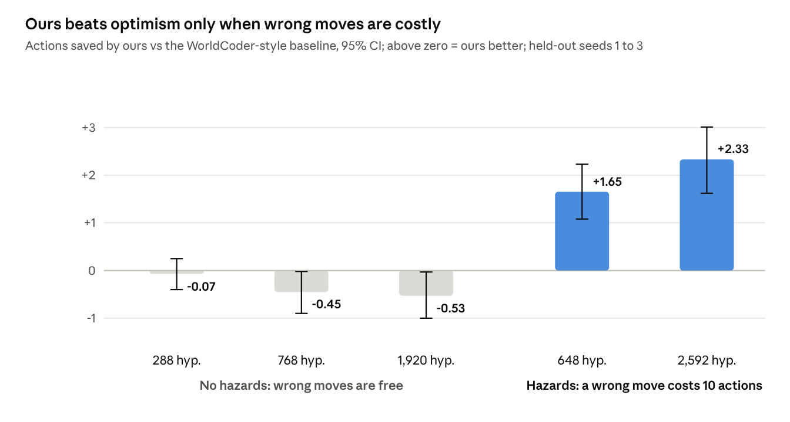
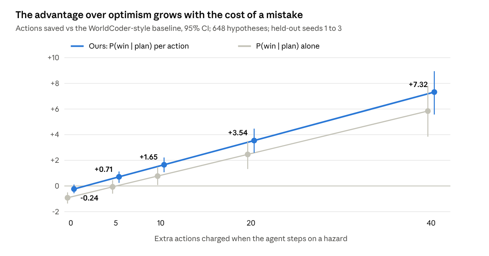

# When Mistakes Cost: Posterior Plan Selection for Program World-Model Agents

<p class="authors">{{AUTHORS}}</p>
<p class="meta">ARC Prize 2026, Paper Track · Code and raw results: {{REPO}} · Linked Kaggle submission: {{KAGGLE}}</p>

## Abstract

Interactive agents with executable world models face a trade-off: identifying an environment fully can waste actions, while acting on an optimistic model risks costly mistakes. We study an uncertainty-aware decision rule that maintains a posterior over competing world-model programs and executes the plan with the highest posterior probability of success per action, replanning when a prediction fails.

In controlled grid games with hidden rules (648 to 2,592 hypotheses in the costly-mistake experiments), and with claims specified before held-out evaluation, this rule requires 1.65 to 2.33 fewer actions than an optimistic single-program baseline when incorrect actions trigger costly resets. It also uses approximately 20 times fewer model simulations in the largest tested setting. A mechanism experiment shows the advantage grows with mistake cost, from no significant advantage at zero cost to 7.32 fewer actions at the highest cost tested. When mistakes are free, optimistic planning is equal or slightly better. Scoring plans against 16 sampled hypotheses matched full posterior scoring with 49 to 190 times fewer simulations. These findings motivate a decision rule that existing program-based agents could adopt, rather than a new world-model architecture.

## 1. Introduction

ARC-AGI-3 asks an agent to learn an unknown game from interaction, and scores it on how few actions it needs. The leading 2026 agents build executable world models: Python programs that predict what each action does, checked against what the agent has seen.

Once an agent can write such programs, a different question decides efficiency: which program should it act on? Two answers dominate. One is to identify the rules fully before committing, which spends actions on details the plan never uses. The other is to act on the most optimistic consistent program, as WorldCoder does, which is fast but walks into mistakes the agent could have foreseen.

We propose a third answer and test when it wins. Our claim is narrow: it holds when wrong actions are costly, and it fails when they are free. ARC-AGI-3 games have game-over states and level resets, so the costly case is the relevant one.

## 2. Prior work

- **EMPA** (Tsividis et al., 2021) does Bayesian inference over game-engine programs and explores toward object types of unknown effect. We use its posterior view, but select plans rather than exploration goals.
- **WorldCoder** (Tang, Key and Ellis, NeurIPS 2024) has an LLM write one world-model program, constrained to be consistent and optimistic about reward. It is our main baseline.
- **2026 ARC-AGI-3 agents.** Kepler (self-reported 100 RHAE on public games), Twin (93.3%, 2.6B tokens), Tycho, Rodionov's executable world models, and "Explore Before You Solve" all build or verify program world models. Tycho reports that repairing models to fit observations better did not improve play. That supports our premise that only plan-relevant uncertainty is worth resolving.
- **ARC Prize 2025 methods** (SOAR; test-time training; TRM, the 2025 paper-track winner with a 7M-parameter network) show the value of program search, adaptation and small, efficient models on static tasks.

Our contribution is not a world-model builder. It is a rule for acting on many of them, which any of these agents could adopt.

## 3. Approach

The agent keeps a set of world-model programs consistent with its history, weighted by description length. For each candidate plan (the shortest win under some sampled program), it estimates the posterior probability that the plan wins, and picks the plan with the best probability per action:

<p class="eq">π* = argmax<sub>π</sub> &nbsp;P(win | π) / |π|</p>

It executes the plan and replans whenever an observation contradicts the prediction of the program it chose. To bound compute, P(win | π) is estimated on N sampled programs rather than the full set.

```python
def choose_plan(H, s, N=16):
    S = sample(H, N)                       # N programs from the posterior
    plans = {shortest_win(h, s): h for h in S}
    def score(plan):                       # P(win | plan) per action
        wins = mean(simulate(g, s, plan).won for g in S)
        return wins / len(plan)
    best = max(plans, key=score)
    return best, plans[best]               # plan and the program it came from

def play(env, H):
    s = env.reset()
    while True:
        plan, h_hat = choose_plan(H, s)
        for a in plan:
            predicted = h_hat.step(s, a)
            observed = env.step(a)
            H = [h for h in H if h.step(s, a) == observed]  # keep consistent programs
            s = observed
            if observed.won:
                return
            if observed != predicted:       # surprise: replan
                break
```

<p class="caption">Figure 1: The decision rule in Python-style pseudocode. It matches <code>rate-sN</code> in <code>pilot2.py</code>.</p>

We also tested a stopping rule from our formal model: take explicit information-gathering actions when fewer than τ of the sampled programs agree with the plan. It made performance worse (section 4.4), so the final rule does not use it.

## 4. Results

### 4.1 ARC-AGI-3 and Kaggle leaderboard

{{KAGGLE_RESULT}}

### 4.2 Controlled grid games

8×8 games with hidden rules: key-to-direction mapping, what each obstacle color does (blocks, passes, or, in hazard games, resets the agent at a cost of 10 actions), and which target color wins. The agent sees only its position and a win flag. We compared our rule against single-hypothesis planning, full identification first, EMPA-style exploration of unknown object types, and WorldCoder-style optimism. All are simplified reimplementations of one mechanism each. Variants were chosen on development seeds. All results are from held-out seeds (3 seeds × 300 games), with 95% bootstrap CIs over games.

<p class="caption">Table 1: Mean actions to win, held-out seeds. Every policy in these rows won 100% of games.</p>

| Setting | Ours (16 samples) | WorldCoder-style | Ours saves [95% CI] |
| --- | --- | --- | --- |
| Hazards, 648 hypotheses | 13.96 | 15.61 | 1.65 [1.08, 2.23] |
| Hazards, 2,592 hypotheses | 15.57 | 17.90 | 2.33 [1.62, 3.01] |
| No hazards, 288 | 11.07 | 10.99 | −0.07 [−0.40, 0.25] |
| No hazards, 768 | 12.43 | 11.98 | −0.45 [−0.90, −0.02] |
| No hazards, 1,920 | 13.54 | 13.01 | −0.53 [−1.00, −0.03] |

With hazards, ours used 14,151 median simulations at 2,592 hypotheses against 282,771 for the optimistic baseline.


<p class="caption">Figure 2: Actions saved by our rule against the WorldCoder-style baseline. Above zero means ours needs fewer actions.</p>

### 4.3 Mechanism and compute

- **Dose-response.** Raising the hazard cost from 0 to 5, 10, 20 and 40 actions raised our saving from −0.24 (CI −0.57 to 0.11) to +0.71, +1.65, +3.54 and +7.32. We predicted this in writing before running it.
- **Sampling.** With 16 samples the final rule matched full posterior scoring at 648 and 2,592 hypotheses, with 49 and 190 times fewer simulations. Eight samples lost about one action at 2,592. Full scoring also beats optimism, so the advantage is not a sampling artifact.


<p class="caption">Figure 3: The advantage over optimism grows with the cost of a mistake (648 hypotheses).</p>

### 4.4 What did not work

- The first version of the rule (P(win | π) alone, no per-action term) lost to optimism on development seeds.
- τ-based stopping with explicit information-gathering actions needed 2.8 to 5.8 more actions. It chose experiments by information alone, ignoring action cost. In hazard games the most informative step is often onto an unknown, possibly dangerous tile, though we have not tested this explanation.

### 4.5 Ablation summary

<p class="caption">Table 2: Hazard games, cost 10, held-out seeds (3 × 300 games). Mean actions to win with 95% CI, and median model simulations per game. Every row won 100% of games except the EMPA-style rows (82.4% and 77.3%).</p>

| Method | Actions, 648 | Simulations, 648 | Actions, 2,592 | Simulations, 2,592 |
| --- | --- | --- | --- | --- |
| **Final rule, 16 samples (ours)** | **13.96** [13.40, 14.52] | 8,932 | **15.57** [14.95, 16.21] | 14,151 |
| w/ full posterior scoring | 14.10 [13.52, 14.72] | 436,870 | 15.71 [15.14, 16.35] | 2,691,429 |
| w/ 32 samples | 13.46 [12.91, 14.06] | 18,411 | 15.81 [15.17, 16.46] | 28,086 |
| w/ 8 samples | 14.11 [13.52, 14.75] | 4,684 | 16.67 [16.00, 17.35] | 8,441 |
| w/o per-action term, P(win \| plan) only | 14.84 [14.21, 15.47] | 8,513 | not run | not run |
| w/ τ = 0.5 stopping | 16.73 [16.07, 17.46] | 11,587 | 20.33 [19.47, 21.18] | 17,808 |
| w/ τ = 0.8 stopping | 18.03 [17.30, 18.72] | 11,640 | 21.34 [20.49, 22.26] | 17,852 |
| WorldCoder-style, optimistic single program | 15.61 [14.93, 16.32] | 69,935 | 17.90 [17.12, 18.70] | 282,771 |
| Single random consistent program | 18.14 [17.29, 18.95] | 1,437 | 21.33 [20.48, 22.25] | 4,632 |
| Full identification first | 22.43 [21.54, 23.34] | 5,890 | 27.91 [26.91, 28.88] | 20,428 |
| EMPA-style, contact unknown object types | 69.66 [62.67, 76.94] | 4,590 | 87.40 [79.40, 95.05] | 17,906 |

## 5. Limitations

- The evidence comes from controlled grid games, not ARC-AGI-3 itself.
- The baselines capture one mechanism of EMPA and WorldCoder each, not the full systems. Our EMPA-style policy walks into hazards, which EMPA would avoid.
- Simulations here are cheap Python steps. Real agents spend compute on LLM calls, which we did not measure.
- Prior-work comparisons rely on abstracts. We have not confirmed from full texts that no 2026 agent already selects plans by posterior agreement.

## 6. Reproducibility

`./reproduce.sh` reruns every experiment (about 20 minutes on 4 CPUs, no GPU), checks that every raw result file is byte-identical, and checks every reported number against `numbers.json`. It passed three times end to end.

## 7. Setup and compute

All experiments ran on 4 CPU cores, with no GPU, using Python 3.13.18 and numpy 2.5.3. Each game uses an 8×8 grid, a 300-action cap and a 10-action hazard penalty unless stated. Development seeds were 101 to 103; reported seeds were 1 to 3, with 300 games each. Confidence intervals are 95% percentile bootstraps over games (2,000 resamples, seed 0), after averaging the three seeds within each game.

## References

- Akyurek, E., Damani, M., Qiu, L., Guo, H., Kim, Y., and Andreas, J. The surprising effectiveness of test-time training for abstract reasoning. arXiv:2411.07279, 2024.
- Chollet, F. On the measure of intelligence. arXiv:1911.01547, 2019.
- Chollet, F., Knoop, M., Kamradt, G., and Landers, B. ARC Prize 2024: Technical report. arXiv:2412.04604, 2024.
- Chollet, F., Knoop, M., Kamradt, G., Landers, B., and Pinkard, H. ARC-AGI-2: A new challenge for frontier AI reasoning systems. arXiv:2505.11831, 2025.
- Chollet, F., Knoop, M., Kamradt, G., and Landers, B. ARC Prize 2025: Technical report. arXiv:2601.10904, 2026.
- Han, L. K. Explore before you solve: The speed–depth trade-off in epistemic agents for ARC-AGI-3. arXiv:2605.25931, 2026.
- Jolicoeur-Martineau, A. Less is more: Recursive reasoning with tiny networks. arXiv:2510.04871, 2025.
- Lehmann, J., Aioanei, A., and Vahdati, S. Tycho: Active abstraction with programmatic world models for ARC-AGI-3. arXiv:2607.28287, 2026.
- Pourcel, J., Colas, C., and Oudeyer, P.-Y. Self-improving language models for evolutionary program synthesis: A case study on ARC-AGI. ICML 2025; arXiv:2507.14172.
- Rodionov, S. Executable world models for ARC-AGI-3 in the era of coding agents. arXiv:2605.05138, 2026.
- Skoutnev, A., Acharya, K., Longhitano, G., Udell, M., Ellis, K., and Drori, I. Twin: Playing an unknown game with a test-time digital twin. arXiv:2608.14490, 2026.
- Tang, H., Key, D., and Ellis, K. WorldCoder, a model-based LLM agent: Building world models by writing code and interacting with the environment. NeurIPS 2024; arXiv:2402.12275.
- Tsividis, P. A., Loula, J., Burga, J., Foss, N., Campero, A., Pouncy, T., Gershman, S. J., and Tenenbaum, J. B. Human-level reinforcement learning through theory-based modeling, exploration, and planning. arXiv:2107.12544, 2021.
- Wu, W. Kepler: Auditable world models for ARC-AGI-3. arXiv:2610.00834, 2026.
